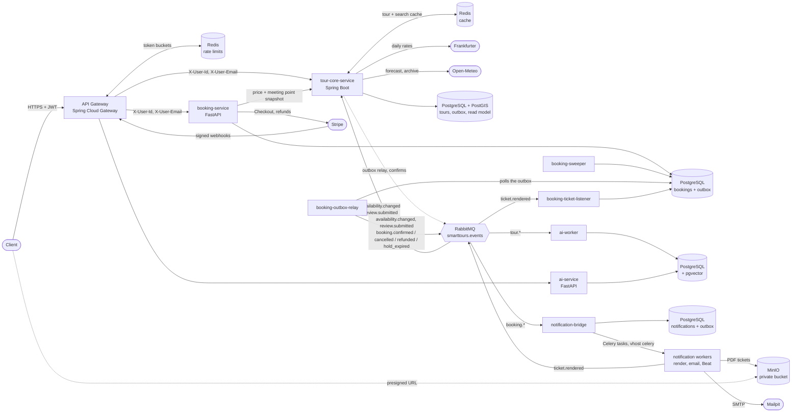
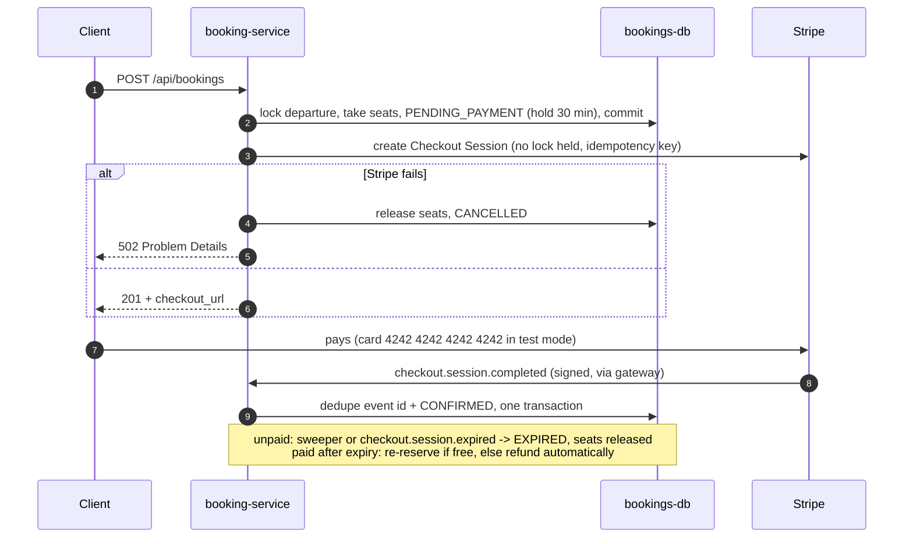

# Smart Tours Distributed API

A polyglot microservices backend for discovering and booking tours in southern Africa. It covers
cache-backed geospatial and full-text search, overbooking-safe seat inventory, transactional outboxes with
an event-fed read model, rate limiting at the edge, booking emails with signed PDF tickets and QR check-in,
and semantic recommendations.


## Architecture



| Service | Stack | Responsibility |
| --- | --- | --- |
| **api-gateway** | Java 21, Spring Boot 4, Spring Cloud Gateway, Spring Security, Redis | Single entry point. Verifies JWTs, enforces roles per route, strips spoofed identity headers and forwards `X-User-Id` / `X-User-Roles`. Rate limits per user or IP with Redis token buckets. |
| **tour-core-service** | Java 21, Spring Boot 4, JPA + jOOQ, PostGIS, Flyway, Redis, Resilience4j | Catalogue with optimistic concurrency (ETag / If-Match) and one search endpoint (geo, full text, facets, ratings, date availability) with keyset pagination and Redis caching. Keeps a read model of departures and ratings fed by booking events. Display prices in five currencies and departure weather from external APIs, behind per-provider resilience policies. |
| **booking-service** | Python 3.12, FastAPI, SQLAlchemy 2, Alembic, Stripe SDK | Departures with price snapshots, seat holds, Stripe Checkout, signed webhooks, cancellation, refunds and verified reviews. Every seat change writes an event to a transactional outbox; separate processes expire holds and relay the outbox. |
| **ai-recommendation-service** | Python 3.12, FastAPI, sentence-transformers, pgvector | Embeds tours from events (separate worker process). "Similar tours" and natural-language search. |
| **notification-service** | Python 3.12, FastAPI, Celery, RabbitMQ, WeasyPrint, MinIO (boto3), SMTP | Turns booking lifecycle events into emails: PDF e-tickets with a signed QR check-in code, cancellations, refunds, expired holds and day-before reminders. An event bridge records each event idempotently and hands the work to Celery workers on their own RabbitMQ vhost. |

Every integration event, its producer, consumers and JSON Schema: [`docs/events.md`](docs/events.md).

Key decisions are recorded in [`docs/adr`](docs/adr/README.md).

## Search

One endpoint, any combination of filters, public through the gateway:

```bash
# Desert tours with a departure in the first half of December that still has 2 seats, cheapest first
curl -s "localhost:8080/api/tours/search?category=DESERT&from=2026-12-01&to=2026-12-15&minSlots=2&sort=price_asc"

# Within 100 km of Windhoek, rated 4.5 or better, nearest first (distanceMeters in every hit)
curl -s "localhost:8080/api/tours/search?lat=-22.5609&lon=17.0658&radius=100000&minRating=4.5"

# Full text with web-search syntax, inside a bounding box (minLon,minLat,maxLon,maxLat), two categories
curl -s "localhost:8080/api/tours/search?q=sunrise%20dunes%20-quad&bbox=14,-26,17,-22&category=DESERT,ADVENTURE"

# Next page: send nextCursor back with the same filters
curl -s "localhost:8080/api/tours/search?category=DESERT&sort=price_asc&cursor=<nextCursor>"
```

| Parameter | Meaning |
| --- | --- |
| `lat`, `lon`, `radius` | Point and radius in metres (max 500 km). Not with `bbox`. |
| `bbox` | `minLon,minLat,maxLon,maxLat`. Must not cross the antimeridian. |
| `q` | Full text (`websearch_to_tsquery`, English stemming; the name weighs more than the description) |
| `minPrice`, `maxPrice` | NAD, inclusive |
| `category`, `difficulty` | One or more, repeated or comma-separated |
| `minDuration`, `maxDuration` | Minutes, inclusive |
| `minRating` | Average of verified reviews, 0 to 5 |
| `from`, `to`, `minSlots` | Has a departure in that date range (Africa/Windhoek days) with at least `minSlots` seats left |
| `sort` | `relevance` (default with `q`), `distance` (default with a point), `price_asc`, `price_desc`, `rating`, `newest` (default otherwise) |
| `size`, `cursor` | Page size up to 100; opaque keyset cursor from the previous page |

Contradictory or out-of-range parameters get one 400 Problem Details listing every problem. The
[OpenAPI document and Swagger UI](http://localhost:8080/docs/tours/swagger-ui.html) describe all of tour-core's
endpoints. Departure availability comes from an event-fed read model and may lag booking-service by a moment;
a booking always checks seats in booking-service itself ([ADR 0008](docs/adr/0008-outbox-and-cqrs-availability-read-model.md)).

## AI: hybrid search and grounded itineraries

Runs with no API key and no paid service. Every modelling choice below was decided by an offline evaluation, and the data behind
them is **synthetic**: [the datasheet](docs/datasets.md), [search quality](docs/benchmarks/search-quality.md),
[itineraries and recommendations](docs/benchmarks/itineraries.md).

```bash
# Phrases become filters, in English or German, relative to Windhoek's clock. The response says what it understood.
curl -s -G localhost:8080/api/ai/search -H "Authorization: Bearer $CUSTOMER" \
  --data-urlencode "q=Kajak bei Walfischbucht unter N\$1500" -d explain=true
# {"understood": {"maxPrice": "unter n$1500", "place": "Walfischbucht"},
#  "results": [{"tourId": 124, "name": "Kajaktour bei Walfischbucht", "price": 1360.00,
#               "explain": {"denseRank": 2, "lexicalRank": 1, "fusedScore": 0.024326, "rerankScore": null}},
#              {"tourId": 29, "name": "Kayaking at Walvis Bay", "price": 1220.00,
#               "explain": {"denseRank": 1, "lexicalRank": null, "fusedScore": 0.016393, "rerankScore": null}}, ...]}

# Also near=lat,lon, radius, maxPrice, from, to, minSlots, lang, mode=hybrid|dense|lexical.

# A plan from real tours with seats on those dates. Add -H 'Accept: text/event-stream' to watch it over SSE.
curl -s localhost:8080/api/ai/itineraries -H "Authorization: Bearer $CUSTOMER" -H 'Content-Type: application/json' \
  -d '{"prompt": "Three days of dunes and wildlife", "startDate": "2026-12-01", "days": 3, "partySize": 2, "budget": "15000.00"}'
# {"path": "deterministic", "fallbackReason": "no_provider", "totalCost": "11580.00", "tokens": {"input": 0, "output": 0},
#  "days": [{"date": "2026-12-01", "items": [{"tourId": 70, "name": "Keetmanshoop dune quad adventure", "cost": "2440.00",
#                                             "travelMinutesFromPrevious": 0, ...}, ...]}, ...]}

# Bookable tours like the ones you booked and liked. New users get what is popular, and "source" says which.
curl -s localhost:8080/api/ai/recommendations/me -H "Authorization: Bearer $CUSTOMER"
```

What the evaluation decided, as nDCG@10 with `paraphrase-multilingual-MiniLM-L12-v2` (U8U8, ONNX) on four query shapes:

| Retrieval | Vague description | Filter phrases | Exact name | Conversational |
| --- | --- | --- | --- | --- |
| Lexical only | 0.459 | 0.476 | 0.876 | 0.196 |
| Dense + query understanding | 0.781 | 0.895 | 0.577 | 0.464 |
| Hybrid + query understanding, equal weights | 0.736 | 0.830 | 0.902 | 0.393 |
| **Hybrid + query understanding, lexical weight 0.5 (chosen)** | **0.752** | **0.880** | **0.878** | **0.417** |

| Runtime, same model | Resident memory | Query p50 | Image |
| --- | --- | --- | --- |
| PyTorch | 901 MB | 18.0 ms | 2.16 GB |
| ONNX | 823 MB | 7.6 ms | |
| ONNX int8, first choice: lost quality without VNNI | 489 MB | 3.7 ms | 615 MB |
| **ONNX U8U8 (chosen)** | **490 MB** | **10 to 25% slower than int8, on shared runners** | **615 MB** |

- **Hybrid retrieval in one SQL statement** ([ADR 0019](docs/adr/0019-hybrid-retrieval-with-rrf-in-one-sql-statement.md)): pgvector,
  full-text search and PostGIS over the same filters, fused by reciprocal rank. The first results said dense search beat hybrid. A
  second test set of exact names reversed that.
- **Model and runtime by evaluation** ([ADR 0020](docs/adr/0020-embedding-model-and-runtime-by-evaluation.md)), with a cross-encoder
  measured and left off, a CI quality gate, and [model migration with no downtime](docs/runbooks/embedding-model-migration.md).
- **Grounded itineraries** ([ADR 0021](docs/adr/0021-grounded-itinerary-generation.md)): a model proposes and code disposes. A validator
  with one rule per way a plan can be wrong, at most two repairs, then a deterministic planner, and the response says which path
  answered. Anthropic, any OpenAI-compatible endpoint (Ollama included), or a Fake: `LLM_PROVIDER`, empty by default. No real model
  has been run yet, and [the benchmark](docs/benchmarks/itineraries.md) says so.
- **Prompt injection is assumed to succeed sometimes** ([threat model](docs/threat-model.md)): the output schema has no free text, and
  every id must be one that retrieval returned, so a fooled model can only choose among real, valid departures.
- **Personalised recommendations** ([ADR 0022](docs/adr/0022-personalised-recommendations.md)), evaluated on a simulated log. Popularity
  alone beats them on hit rate there, and the reasons for shipping them anyway are written down.

## Prices in your currency, weather for your departure

Prices are stored and charged in NAD. Any tour, list or search response can add a display price in ZAR, USD,
EUR, GBP or BWP, and tour detail can embed the weather for a departure. Both come from free public APIs
(Frankfurter, Open-Meteo) and neither can slow down or break the tour page.

```bash
# Display price (display only: bookings are charged in NAD, and every booking response says so)
curl -s "localhost:8080/api/tours/1?currency=EUR"
#  "price": 1850.00, "currency": "NAD",
#  "displayPrice": {"amount": 99.58, "currency": "EUR", "rate": 0.053827, "rateAsOf": "2026-11-03", "stale": false}

# Price bounds in the display currency: 99 to 100 EUR is searched as 1839.22 to 1857.81 NAD
curl -s "localhost:8080/api/tours/search?category=DESERT&currency=EUR&minPrice=99&maxPrice=100"

# Weather for a departure: a forecast up to 15 days ahead, else the same week averaged over the last 10 years
curl -s "localhost:8080/api/tours/1/weather?date=2026-11-08"
#  "weather": {"type": "forecast", "temperatureMaxC": 34.4, "description": "Clear sky", "sunrise": "06:08:00", ...},
#  "weatherStatus": "ok", "attribution": {"text": "Weather data by Open-Meteo.com", ...}
curl -s "localhost:8080/api/tours/1?include=weather"     # date defaults to the next departure with seats
```

| When | `displayPrice` | `weather` / `weatherStatus` | HTTP |
| --- | --- | --- | --- |
| everything healthy | present, `stale: false` | the forecast or climate normal / `ok` | 200 |
| rates 5 to 14 days old (missed refreshes) | present, `stale: true` | | 200 |
| rates older than 14 days | absent, `displayPriceUnavailable` says why | | 200 |
| weather provider slow, failing or its circuit open | unaffected | last cached value with `stale: true` / `stale`, else `null` / `unavailable` | 200 |
| unsupported currency, past date | | | 400 Problem Details |

Rates are fetched once a day on one instance (ShedLock), checked (no quote may move more than 10%, NAD/ZAR must
hold its 1:1 peg within 0.5%) and read from memory, so they are never on the request path. The tour page waits
at most 400 ms for weather; every outbound call has a time limit, retries with jittered backoff (honouring
Retry-After), a circuit breaker and a thread-pool bulkhead. Decisions: [ADR 0011](docs/adr/0011-display-only-currency-conversion.md)
(currency) and [ADR 0012](docs/adr/0012-resilience-policy-for-outbound-calls.md) (resilience). Open-Meteo's free
API is for non-commercial use; ADR 0012 lists what changes for a commercial launch.

## Booking flow

A booking is a saga of local transactions with a compensation for each step, not a distributed
transaction ([ADR 0006](docs/adr/0006-hold-then-pay-booking-saga.md)).



| Status | Meaning | Seats counted |
| --- | --- | --- |
| `PENDING_PAYMENT` | Seats held until `hold_expires_at`, checkout open | yes |
| `CONFIRMED` | Paid | yes |
| `EXPIRED` | Hold lapsed unpaid | no |
| `CANCELLED` | Cancelled (hold released, or confirmed within 48 h: no refund) | no |
| `REFUNDED` | Cancelled more than 48 h before departure, or paid too late for a seat | no |

### Endpoints (through the gateway on :8080)

| Method and path | Who | What |
| --- | --- | --- |
| `POST /api/availability` | OPERATOR | Open a departure. Validates the tour with tour-core and snapshots its price. |
| `GET /api/availability?tour_id=` | any user | Departures with `unit_price`, `currency`, `slots_remaining` |
| `POST /api/bookings` | any user | Hold seats; returns `checkout_url`. `Idempotency-Key` header makes retries safe. |
| `GET /api/bookings/me`, `GET /api/bookings/{id}` | owner | Booking, payment status, hold expiry |
| `POST /api/bookings/{id}/cancel` | owner | Release a hold, or cancel under the refund policy (explained in `cancellation`) |
| `POST /api/bookings/{id}/review` | owner | Rate a confirmed trip once it has started (1 to 5, once); feeds the tour's average in tour-core |
| `GET /api/bookings/{id}/ticket` | owner | 302 to a 5-minute presigned URL for the PDF ticket; 404 `ticket-not-ready` until it is rendered |
| `POST /api/check-ins` | OPERATOR | Scan a ticket's QR token: accepted once, on the day of departure in the tour's time zone ([ADR 0015](docs/adr/0015-signed-qr-check-in-tokens-and-object-storage.md)) |
| `POST /webhooks/stripe` | Stripe (public, signature-verified) | Payment events |

## Engineering highlights

- **Three locking strategies, measured.** Seat reservation sits behind a strategy interface: pessimistic
  `FOR UPDATE`, optimistic version compare-and-swap, or one conditional `UPDATE`. All three pass the same
  concurrency tests. In a k6 benchmark through the gateway (100 users, 1,000 attempts, 500 seats), each sold exactly
  500; the conditional `UPDATE` won at 95 req/s and a p95 of 2,969 ms, against 91 and 3,133 for pessimistic and 71 and
  3,937 for optimistic, median of three rounds on a laptop ([results](docs/benchmarks/booking-locking.md)).
- **Search with measured indexes.** One jOOQ-built query over geo, full text, facets, ratings and date
  availability, keyset-paginated. On 100k tours, EXPLAIN before and after each index decided what stays:
  a keyset page at depth ~1000 reads 24 buffers (OFFSET at the same depth: 19,866), and nearest-first uses
  PostGIS KNN through a two-step query (118 ms to 0.85 ms), because a plain `ORDER BY distance, id` never does
  ([plans](docs/benchmarks/search.md)).
- **Outbox and CQRS read model.** Every seat change writes its event in the same transaction (checked after
  every test in the suite); a relay publishes with confirms, at least once; tour-core applies events by version,
  safe against duplicates and reordering ([ADR 0008](docs/adr/0008-outbox-and-cqrs-availability-read-model.md)).
  Measured as an A/B against Phase 1 under contention: 14% less throughput on a CPU-bound laptop, no change in
  correctness ([results](docs/benchmarks/booking-locking.md#phase-2-transactional-outbox-atomic-strategy-ab)).
- **Caching that can fail.** Redis first pages keyed by a catalogue generation (no SCAN/KEYS), jittered TTLs,
  single-flight on misses, and Redis down costs latency, not availability (tested by stopping Redis mid-test).
  On a laptop, a realistic search mix through the gateway runs at a median of 15 to 19 ms at 20 req/s and
  tops out around 80 req/s ([load test](docs/benchmarks/search.md#load-test-k6-through-the-gateway)).
- **Designed for failure, measured.** Exchange rates and weather come from free APIs behind Resilience4j
  (time limit, retry with jitter and Retry-After, circuit breaker, thread-pool bulkhead per provider) and a
  stale-if-error cache. Under k6 at 40 req/s with every provider dead, the tour page's p95 was 9.9 ms, against
  9.4 ms with a warm cache (median of three rounds, no errors); with a provider answering in 2 s it was bounded by
  the 400 ms weather budget (p95 406 ms), and 12.5 ms once the breaker opened
  ([results](docs/benchmarks/integrations.md)). Every failure mode also has a WireMock test.
- **Two token issuers, safely.** Keycloak (RS256, JWKS, code flow with PKCE, no password grant) and local dev tokens
  through Spring Security's issuer resolver, each locked to its own algorithm and key, with a required audience. The
  production profile refuses to start with dev tokens on. Tests run the repo's realm in a real Keycloak
  ([ADR 0016](docs/adr/0016-keycloak-and-multi-issuer-validation.md)).
- **Emails that don't wait behind PDFs.** Rendering and sending have a queue and a worker pool each, with a chain per
  booking. In a burst of 500 confirmations on one render process, the median email went from 343.9 s to 177.3 s
  after the booking, and a rendered ticket's email leaves in 0.05 s at the median (0.77 s at worst). Renders still
  limit the total: 1.30 emails/s and about the same p99 ([results](docs/benchmarks/notifications.md)).
- **One trace through the outbox.** Each outbox row keeps the `traceparent` of the transaction that wrote it, so one
  trace runs from the payment webhook through the relay, RabbitMQ, the Celery chain and the email, in five services
  ([ADR 0017](docs/adr/0017-observability-and-trace-propagation-through-the-outbox.md)). Dashboards, SLOs and
  burn-rate alerts are code ([SLOs](docs/slo.md)).
- **A garbage collector chosen by measurement.** Serial against G1 and ZGC under the container limits: tour-core's
  peak RSS was 525 to 567 MiB against 626 to 701 and 764 to 777 (limit 768). G1's tail was a few milliseconds better,
  which is the trade taken ([results](docs/benchmarks/jvm.md), [ADR 0018](docs/adr/0018-serial-gc-for-both-jvms.md)).
- **Rate limits per caller.** Redis token buckets at the gateway keyed by JWT subject or a proxy-aware client IP,
  429 Problem Details with `Retry-After`, fail-open for reads and fail-closed for seat holds
  ([ADR 0010](docs/adr/0010-rate-limiting-at-the-gateway.md)).
- **Payments that can't lose money or seats.** Hold-then-pay saga with compensations, Stripe calls made
  outside every lock, signed and deduplicated webhooks, automatic refund when a payment arrives after its
  hold expired and the seats are gone, and a provider interface so a Namibian PSP can replace Stripe.
- **No overbooking under contention.** 50 concurrent requests for 10 seats book exactly 10, verified against real
  PostgreSQL in [`test_concurrency.py`](booking-service/tests/test_concurrency.py). A control test reproduces the
  lost update that happens without the lock, and a `CHECK` constraint backs up the application logic.
- **Idempotent writes.** `Idempotency-Key` on bookings: a retried request returns the original booking instead
  of charging twice.
- **Database per service.** One PostgreSQL database per service, each schema owned by its own migrations
  (Flyway / Alembic).
- **Resilient messaging.** Typed events with ids, consumer-owned quorum queues, a TTL retry queue and a
  dead-letter queue, so a malformed message can't block the pipeline.
- **Security at the edge.** Standard OAuth2 resource server, CORS by explicit origin, security headers and request
  limits. Identity is never taken from request bodies. A STRIDE pass maps each threat to its mitigation or an accepted
  risk ([threat model](docs/threat-model.md)).
- **Hardened containers and supply chain.** Non-root, no capabilities and read-only filesystems on application
  containers; Trivy and an SBOM per image, gitleaks over the whole history and Dependabot in CI.
- **Consistent errors.** RFC 9457 Problem Details (`application/problem+json`) from every service.
- **Model choices by evaluation, negative results included.** Labels reviewed by the owner, paired bootstrap intervals, and a CI
  quality gate. When the gate disagreed with itself on one commit, a survey of 48 runner jobs traced it to an int8 file that lost
  quality on CPUs without VNNI. The fix shipped with that evidence, and model files are now pinned by revision and hash. A
  pre-registered held-out test then rejected a ranking tweak that looked like a clear gain on the queries it was tuned on
  ([search quality](docs/benchmarks/search-quality.md)).

## Quickstart

Requirements: Docker with Compose v2.

```bash
cp .env.example .env                                   # then replace every change-me value
# a strong JWT secret:  openssl rand -base64 48
python scripts/ticket_keys.py                          # once: the key that signs ticket QR codes
docker compose up --build                              # the core; add profiles for the rest (below)
```

### Profiles

The default `docker compose up` is the core (gateway, tour-core, booking with its sweeper and relay, their
databases, RabbitMQ, two Redis); everything optional is a profile, so the core fits on an 8 GB laptop. Every
container has a memory limit ([memory](docs/benchmarks/notifications.md#memory-budget)).

| Profile | Adds | For |
| --- | --- | --- |
| *(none)* | the core | search, booking, payments with the fake provider, sections 0 to 8 of the smoke test |
| `observability` | Collector, Tempo, Prometheus, Loki and Grafana in one container (with `--env-file infra/observability/observability.env`) | traces, dashboards and alerts: http://127.0.0.1:3001 ([section 12 of the smoke test](docs/smoke-test.md#12-one-trace-dashboards-and-alerts-observability-profile)) |
| `auth` | Keycloak and its database (about 610 MiB; `python scripts/keycloak_secrets.py` first) | real login and RS256 tokens, [section 11 of the smoke test](docs/smoke-test.md#11-real-tokens-from-keycloak-auth-profile) |
| `ai` | ai-service, ai-worker, ai-db (about 1,125 MiB) | hybrid search, itineraries, recommendations; the first start downloads the embedding model (118 MB). `python scripts/seed_ai_catalogue.py` fills it with the synthetic dataset |
| `notifications` | notification-service, -bridge, -worker, -beat, notifications-db, MinIO, Mailpit, booking-ticket-listener | emails (http://localhost:8025), PDF tickets, check-in |
| `flower` | Flower, Celery's dashboard (http://localhost:5555) | with `notifications` |
| `payments` | Stripe CLI webhook forwarding | Stripe test mode |
| `chaos` | WireMock provider stubs (with `--env-file infra/chaos/chaos.env`) | the integrations benchmark, provider faults |

```bash
docker compose --profile notifications up -d --wait     # the core plus notifications
docker compose --profile ai --profile notifications up   # everything
```

### Try it

```bash
OPERATOR=$(python scripts/dev_token.py --sub op-1 --roles OPERATOR)
CUSTOMER=$(python scripts/dev_token.py --sub alice)

# Create a tour (operator only)
curl -s -X POST localhost:8080/api/tours -H "Authorization: Bearer $OPERATOR" -H 'Content-Type: application/json' \
  -d '{"name":"Sossusvlei Sunrise Dunes","description":"Climb Dune 45 at dawn","price":1850.00,"latitude":-24.7275,"longitude":15.3424,"category":"DESERT","difficulty":"MODERATE","durationMinutes":300}'

# Tours within 400 km of Windhoek (public)
curl -s "localhost:8080/api/tours/nearby?lat=-22.5609&lon=17.0658&radius=400000"

# Open a departure with 10 seats (price snapshotted from tour-core), then hold 2 of them, safely retryable
curl -s -X POST localhost:8080/api/availability -H "Authorization: Bearer $OPERATOR" -H 'Content-Type: application/json' \
  -d '{"tour_id":1,"starts_at":"2026-12-01T05:30:00+02:00","total_slots":10}'
curl -s -X POST localhost:8080/api/bookings -H "Authorization: Bearer $CUSTOMER" -H 'Idempotency-Key: 7f9c' \
  -H 'Content-Type: application/json' -d '{"availability_id":1,"slots":2}'   # PENDING_PAYMENT + checkout_url

# Pay for it. With the default fake provider, send the signed webhook Stripe would send:
python scripts/fake_webhook.py --booking 1                                     # -> CONFIRMED

# Hybrid search over tour descriptions: see "AI" above
curl -s "localhost:8080/api/ai/search?q=sunrise+in+the+desert" -H "Authorization: Bearer $CUSTOMER"
```

RabbitMQ management UI: http://localhost:15672 (credentials from `.env`). For real Stripe test-mode
payments see [docs/smoke-test.md](docs/smoke-test.md#7-stripe-test-mode).

### Configuration (`.env`)

| Variable | Default | Purpose |
| --- | --- | --- |
| `DEV_TOKENS_ENABLED` | `true` in compose | Accept `dev_token.py`'s HS256 tokens. The gateway's `prod` profile refuses to start with this on ([ADR 0016](docs/adr/0016-keycloak-and-multi-issuer-validation.md)) |
| `JWT_SECRET` | none, required | HS256 key shared by the gateway and `dev_token.py` |
| `CORS_ALLOWED_ORIGINS` | empty | Browser origins allowed to call the API, comma separated |
| `KEYCLOAK_PUBLIC_URL` | `http://localhost:8180` | Keycloak's public URL, which becomes every token's `iss` |
| `KEYCLOAK_WEB_ORIGIN` | `http://localhost:3000` | Where the front-end client may redirect to after login |
| `*_DB_USER`, `*_DB_PASSWORD` | none, required | One database per service |
| `RABBITMQ_USER`, `RABBITMQ_PASSWORD` | none, required | Broker credentials |
| `PAYMENT_PROVIDER` | `fake` | `fake` (no account needed) or `stripe` (test mode) |
| `STRIPE_SECRET_KEY` | empty | `sk_test_...`, only for `PAYMENT_PROVIDER=stripe` |
| `STRIPE_WEBHOOK_SECRET` | none, required | Webhook signing secret: `whsec_...` from the Stripe CLI, or any random string for `fake` |
| `CHECKOUT_SUCCESS_URL`, `CHECKOUT_CANCEL_URL` | `localhost:3000/bookings/{booking_id}?...` | Where Checkout sends the customer afterwards |
| `HOLD_MINUTES` | `30` | Seat hold while paying (32 with Stripe: a session lives at least 30 minutes) |
| `CANCELLATION_FULL_REFUND_HOURS` | `48` | Full refund when cancelled earlier than this before departure |
| `RESERVATION_STRATEGY` | `atomic` | `atomic`, `pessimistic` or `optimistic`, chosen by benchmark ([ADR 0002](docs/adr/0002-pessimistic-locking-for-bookings.md)) |
| `BOOKING_WEB_CONCURRENCY` | `4` | uvicorn worker processes for booking-service |
| `RATE_LIMIT_*` | see `.env.example` | Token-bucket budgets per route ([ADR 0010](docs/adr/0010-rate-limiting-at-the-gateway.md)) |
| `RATE_LIMIT_TRUSTED_PROXIES` | empty | CIDRs of load balancers whose `X-Forwarded-For` is believed |
| `FX_FRESH_DAYS`, `FX_MAX_AGE_DAYS` | `4`, `14` | Rates up to this old are fresh, then stale, then not used ([ADR 0011](docs/adr/0011-display-only-currency-conversion.md)) |
| `FX_MAX_MOVE_PERCENT`, `FX_PEG_TOLERANCE_PERCENT` | `10`, `0.5` | Sanity checks a fetch must pass to replace the rates in use |
| `FX_REFRESH_CRON`, `FX_REFRESH_ON_STARTUP` | `0 15 18 * * *`, `true` | Daily refresh (Africa/Windhoek, one instance via ShedLock), and at start-up if none today |
| `WEATHER_INCLUDE_BUDGET`, `WEATHER_REQUEST_BUDGET` | `400ms`, `3s` | How long tour detail and `/weather` wait for Open-Meteo ([ADR 0012](docs/adr/0012-resilience-policy-for-outbound-calls.md)) |
| `FRANKFURTER_BASE_URL`, `OPEN_METEO_*_BASE_URL` | the public APIs | Provider endpoints; `infra/chaos/chaos.env` points them at the WireMock stubs |
| `OPEN_METEO_API_KEY` | empty | Commercial Open-Meteo: switches to the customer hosts with the key |
| `WARM_UP_ENABLED` | `true` | tour-core sends its hot requests to itself before reporting ready |
| `NOTIFICATIONS_DB_*`, `MINIO_ROOT_*`, `TICKETS_WRITER_SECRET_KEY`, `TICKETS_READER_SECRET_KEY` | none, required for `notifications` | notification-service's database, object storage and its two least-privilege users |
| `NOTIFICATION_WORKER_CONCURRENCY`, `NOTIFICATION_EMAIL_WORKER_CONCURRENCY`, `NOTIFICATIONS_SEND_RATE_LIMIT` | `2`, `2`, `10/s` | Celery processes in the render worker and in the email worker, and the per-worker email rate limit |
| `TICKETS_S3_PUBLIC_ENDPOINT_URL` | `http://localhost:9000` | Where the browser reaches object storage: presigned ticket URLs are signed for this host |
| `FLOWER_BASIC_AUTH` | none, required for `flower` | `user:password` for Flower |

## Running the tests

```bash
api-gateway/mvnw -f pom.xml verify   # both Java services, no local Maven needed; Testcontainers runs PostGIS in Docker

cd booking-service
pip install -r requirements-dev.txt
docker compose up -d bookings-db
createdb -h 127.0.0.1 -p 5434 -U bookings bookings_test   # once
TEST_DATABASE_URL=postgresql+psycopg://bookings:<password>@127.0.0.1:5434/bookings_test \
TEST_RABBITMQ_URL=amqp://<user>:<password>@127.0.0.1:5672/%2F pytest   # RabbitMQ is optional locally
```

tour-core's jOOQ classes are generated from the Flyway migrations and committed (`src/main/generated`). After
changing a migration, regenerate them (needs Docker) and commit the result. CI fails when they are stale:

```bash
cd tour-core-service && ./mvnw -Pjooq-codegen generate-sources
```

No test calls Frankfurter or Open-Meteo either: tour-core's adapters are tested against WireMock with responses
recorded from the real APIs (`src/test/resources/fixtures`), including timeouts, 5xx, 429 with Retry-After,
connection resets, malformed JSON, circuit opening and half-open recovery, and bulkhead rejection.

No test calls Stripe or tour-core: payments use the fake provider, tour-core and Stripe's HTTP API are
mocked with respx, and webhooks are signed in the tests with a test secret. CI needs no Stripe secrets.

Benchmark the reservation strategies (needs the stack running; k6 runs in Docker):

```bash
python benchmarks/run_booking_contention.py        # writes docs/benchmarks/booking-locking.md
python benchmarks/run_search_benchmark.py --seed   # 100k tours; cold vs warm cache; a rate-limit burst
python benchmarks/run_integrations_benchmark.py    # tour page while providers are slow or dead (chaos profile)
python benchmarks/run_gc_comparison.py             # Serial, G1 and ZGC under the container limits
```

notification-service's tests need WeasyPrint's system libraries, so they run in its test image against the
notifications profile (real Postgres, RabbitMQ, MinIO and Mailpit, and a real Celery worker):

```bash
docker compose --profile notifications up -d --wait
docker build --target test -t notification-service:test notification-service
# then docker run it on the compose network with TEST_* variables: see notification-service/tests/conftest.py
```

Each producer's tests validate the events it publishes against `docs/events/*.schema.json`. CI runs all of this on
every push: [`.github/workflows/ci.yml`](.github/workflows/ci.yml).

## Roadmap

| Phase | Scope | Status |
| --- | --- | --- |
| 0 | Make it run: fixes, per-service databases, migrations, Dockerfiles, CI, ADRs | Done |
| 1 | Booking core: payment hold → Stripe Checkout → signed webhooks → confirm/expire; locking benchmark with k6 | Done |
| 2 | Search and caching: dynamic filters, distance sort, keyset pagination, CQRS availability, Redis, rate limiting | Done |
| 3 | Integrations: currency (Frankfurter, NAD base) and weather (Open-Meteo) behind Resilience4j, chaos profile | Done |
| 4 | Async workers: tour-core outbox, booking lifecycle events, notification-service (Celery), PDF tickets with QR check-in, compose profiles | Done |
| 5 | Production ops: Keycloak, OpenTelemetry + Grafana, SLOs and alerts, security hardening and supply-chain scanning | Done |
| 5, Part B | Live deployment: OpenTofu, k3s, Argo CD, TLS, restore drill | Parked |
| 6 | AI: hybrid search by evaluation, grounded itineraries with validation and fallback, personalised recommendations | Done, with no real LLM run yet |

## Repository layout

```
api-gateway/                 Spring Cloud Gateway, security
tour-core-service/           Spring Boot, PostGIS, Flyway
booking-service/             FastAPI, SQLAlchemy, Alembic, payments, reviews, hold sweeper, outbox relay
ai-recommendation-service/   FastAPI API + RabbitMQ worker, pgvector
notification-service/        FastAPI admin API, event bridge, Celery workers and Beat, PDF tickets, email
docs/adr/                    Architecture decision records
docs/runbooks/               Operational procedures (ticket key rotation)
docs/events.md, docs/events/ Every integration event, with its JSON Schema (the producers' contract tests read them)
docs/benchmarks/             Measured results: locking, search, integrations, notifications, memory, garbage collectors
docs/slo.md, docs/threat-model.md  Service level objectives; a STRIDE pass over the exposed parts
benchmarks/                  k6 scenarios (booking contention, search, integrations) and the scripts that run them
infra/chaos/                 WireMock stubs for Frankfurter and Open-Meteo with switchable faults (compose profile chaos)
infra/observability/         Prometheus scrape config, dashboards and alert rules as code (compose profile observability)
infra/keycloak/              Keycloak's image and the realm as code (compose profile auth)
infra/minio/                 The tickets bucket and its least-privilege users (compose profile notifications)
scripts/seed_tours.sql       100k realistic tours and departures for search benchmarks (dev only)
scripts/dev_token.py         Mint local JWTs, for the default stack without Keycloak
scripts/keycloak_secrets.py  Generate the auth profile's secrets (into secrets/, git-ignored)
scripts/keycloak_token.py    A real Keycloak token per demo user, through the real login form
scripts/trace_booking.py     One booking end to end, then checks in Tempo that its trace is whole
scripts/fake_webhook.py      Send a signed Stripe-format webhook (fake provider)
scripts/chaos.py             Switch the provider stubs between healthy, slow, errors and dead
scripts/ticket_keys.py       Ticket check-in signing keys: create, rotate, retire (into secrets/, git-ignored)
scripts/read_ticket_qr.py    Read the check-in token from a ticket PDF's QR code, as a scanner would
docker-compose.yml           Local stack: the core by default, optional pieces as profiles
```
