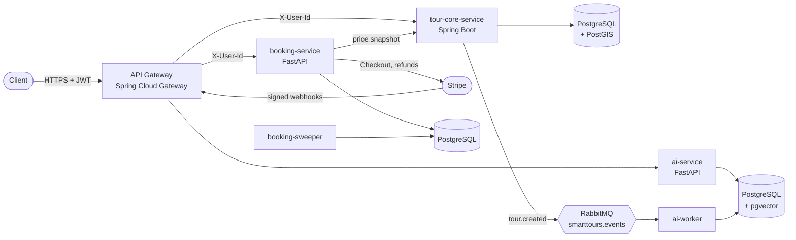
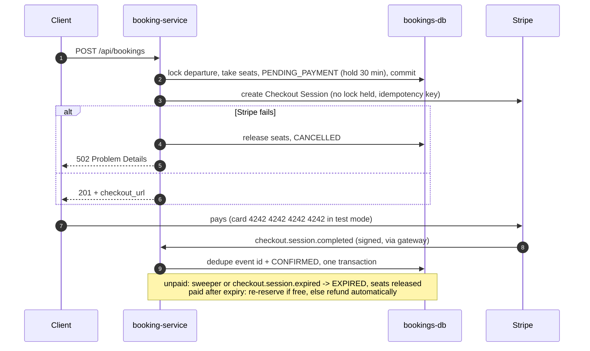

# Smart Tours Distributed API

A polyglot microservices backend for discovering and booking tours in southern Africa. It covers
geospatial search, overbooking-safe seat inventory, event-driven processing and semantic recommendations.


## Architecture



| Service | Stack | Responsibility |
| --- | --- | --- |
| **api-gateway** | Java 21, Spring Boot 4, Spring Cloud Gateway, Spring Security | Single entry point. Verifies JWTs, enforces roles per route, strips spoofed identity headers and forwards `X-User-Id` / `X-User-Roles`. |
| **tour-core-service** | Java 21, Spring Boot 4, JPA/Hibernate Spatial, Flyway | Tour catalogue and radius search (PostGIS `ST_DWithin` on a GiST index). Publishes `tour.created` after commit. |
| **booking-service** | Python 3.12, FastAPI, SQLAlchemy 2, Alembic, Stripe SDK | Departures with price snapshots, seat holds, Stripe Checkout, signed webhooks, cancellation and refunds. A separate sweeper process expires unpaid holds. |
| **ai-recommendation-service** | Python 3.12, FastAPI, sentence-transformers, pgvector | Embeds tours from events (separate worker process). "Similar tours" and natural-language search. |

Key decisions are recorded in [`docs/adr`](docs/adr/README.md).

## Booking flow

A booking is a saga of local transactions with a compensation for each step, not a distributed
transaction ([ADR 0006](docs/adr/0006-hold-then-pay-booking-saga.md)).



| Status | Meaning | Seats counted |
| --- | --- | --- |
| `PENDING_PAYMENT` | Seats held until `hold_expires_at`, checkout open | yes |
| `CONFIRMED` | Paid | yes |
| `EXPIRED` | Hold lapsed unpaid | no |
| `CANCELLED` | Cancelled (hold released, or confirmed within 48 h: no refund) | no |
| `REFUNDED` | Cancelled more than 48 h before departure, or paid too late for a seat | no |

### Endpoints (through the gateway on :8080)

| Method and path | Who | What |
| --- | --- | --- |
| `POST /api/availability` | OPERATOR | Open a departure. Validates the tour with tour-core and snapshots its price. |
| `GET /api/availability?tour_id=` | any user | Departures with `unit_price`, `currency`, `slots_remaining` |
| `POST /api/bookings` | any user | Hold seats; returns `checkout_url`. `Idempotency-Key` header makes retries safe. |
| `GET /api/bookings/me`, `GET /api/bookings/{id}` | owner | Booking, payment status, hold expiry |
| `POST /api/bookings/{id}/cancel` | owner | Release a hold, or cancel under the refund policy (explained in `cancellation`) |
| `POST /webhooks/stripe` | Stripe (public, signature-verified) | Payment events |

## Engineering highlights

- **Three locking strategies, measured.** Seat reservation sits behind a strategy interface: pessimistic
  `FOR UPDATE`, optimistic version compare-and-swap, or one conditional `UPDATE`. All three pass the same
  concurrency tests, and a k6 benchmark through the gateway compares them
  ([results](docs/benchmarks/booking-locking.md)).
- **Payments that can't lose money or seats.** Hold-then-pay saga with compensations, Stripe calls made
  outside every lock, signed and deduplicated webhooks, automatic refund when a payment arrives after its
  hold expired and the seats are gone, and a provider interface so a Namibian PSP can replace Stripe.
- **No overbooking under contention.** 50 concurrent requests for 10 seats book exactly 10, verified against real
  PostgreSQL in [`test_concurrency.py`](booking-service/tests/test_concurrency.py). A control test reproduces the
  lost update that happens without the lock, and a `CHECK` constraint backs up the application logic.
- **Idempotent writes.** `Idempotency-Key` on bookings: a retried request returns the original booking instead
  of charging twice.
- **Database per service.** Three PostgreSQL instances, each schema owned by its own migrations (Flyway / Alembic).
- **Resilient messaging.** Typed events with ids, consumer-owned quorum queues, a TTL retry queue and a
  dead-letter queue, so a malformed message can't block the pipeline.
- **Security at the edge.** Standard OAuth2 resource server (Keycloak-ready). Identity is never taken from
  request bodies.
- **Consistent errors.** RFC 9457 Problem Details (`application/problem+json`) from every service.

## Quickstart

Requirements: Docker with Compose v2.

```bash
cp .env.example .env                                   # then replace every change-me value
# a strong JWT secret:  openssl rand -base64 48
docker compose up --build
```

The first build downloads the embedding model (~90 MB) into a volume. After that, start-up takes seconds.

### Try it

```bash
OPERATOR=$(python scripts/dev_token.py --sub op-1 --roles OPERATOR)
CUSTOMER=$(python scripts/dev_token.py --sub alice)

# Create a tour (operator only)
curl -s -X POST localhost:8080/api/tours -H "Authorization: Bearer $OPERATOR" -H 'Content-Type: application/json' \
  -d '{"name":"Sossusvlei Sunrise Dunes","description":"Climb Dune 45 at dawn","price":1850.00,"latitude":-24.7275,"longitude":15.3424}'

# Tours within 400 km of Windhoek (public)
curl -s "localhost:8080/api/tours/nearby?lat=-22.5609&lon=17.0658&radius=400000"

# Open a departure with 10 seats (price snapshotted from tour-core), then hold 2 of them, safely retryable
curl -s -X POST localhost:8080/api/availability -H "Authorization: Bearer $OPERATOR" -H 'Content-Type: application/json' \
  -d '{"tour_id":1,"starts_at":"2026-12-01T05:30:00+02:00","total_slots":10}'
curl -s -X POST localhost:8080/api/bookings -H "Authorization: Bearer $CUSTOMER" -H 'Idempotency-Key: 7f9c' \
  -H 'Content-Type: application/json' -d '{"availability_id":1,"slots":2}'   # PENDING_PAYMENT + checkout_url

# Pay for it. With the default fake provider, send the signed webhook Stripe would send:
python scripts/fake_webhook.py --booking 1                                     # -> CONFIRMED

# Semantic search over tour descriptions
curl -s "localhost:8080/api/ai/search?q=sunrise+in+the+desert" -H "Authorization: Bearer $CUSTOMER"
```

RabbitMQ management UI: http://localhost:15672 (credentials from `.env`). For real Stripe test-mode
payments see [docs/smoke-test.md](docs/smoke-test.md#7-stripe-test-mode).

### Configuration (`.env`)

| Variable | Default | Purpose |
| --- | --- | --- |
| `JWT_SECRET` | none, required | HS256 key shared by the gateway and `dev_token.py` |
| `*_DB_USER`, `*_DB_PASSWORD` | none, required | One database per service |
| `RABBITMQ_USER`, `RABBITMQ_PASSWORD` | none, required | Broker credentials |
| `PAYMENT_PROVIDER` | `fake` | `fake` (no account needed) or `stripe` (test mode) |
| `STRIPE_SECRET_KEY` | empty | `sk_test_...`, only for `PAYMENT_PROVIDER=stripe` |
| `STRIPE_WEBHOOK_SECRET` | none, required | Webhook signing secret: `whsec_...` from the Stripe CLI, or any random string for `fake` |
| `CHECKOUT_SUCCESS_URL`, `CHECKOUT_CANCEL_URL` | `localhost:3000/bookings/{booking_id}?...` | Where Checkout sends the customer afterwards |
| `HOLD_MINUTES` | `30` | Seat hold while paying (32 with Stripe: a session lives at least 30 minutes) |
| `CANCELLATION_FULL_REFUND_HOURS` | `48` | Full refund when cancelled earlier than this before departure |
| `RESERVATION_STRATEGY` | `atomic` | `atomic`, `pessimistic` or `optimistic`, chosen by benchmark ([ADR 0002](docs/adr/0002-pessimistic-locking-for-bookings.md)) |
| `BOOKING_WEB_CONCURRENCY` | `4` | uvicorn worker processes for booking-service |

## Running the tests

```bash
api-gateway/mvnw -f pom.xml verify   # both Java services, no local Maven needed; Testcontainers runs PostGIS in Docker

cd booking-service
pip install -r requirements-dev.txt
docker compose up -d bookings-db
createdb -h 127.0.0.1 -p 5434 -U bookings bookings_test   # once
TEST_DATABASE_URL=postgresql+psycopg://bookings:<password>@127.0.0.1:5434/bookings_test pytest
```

No test calls Stripe or tour-core: payments use the fake provider, tour-core and Stripe's HTTP API are
mocked with respx, and webhooks are signed in the tests with a test secret. CI needs no Stripe secrets.

Benchmark the reservation strategies (needs the stack running; k6 runs in Docker):

```bash
python benchmarks/run_booking_contention.py   # writes docs/benchmarks/booking-locking.md
```

CI runs all of this on every push: [`.github/workflows/ci.yml`](.github/workflows/ci.yml).

## Roadmap

| Phase | Scope | Status |
| --- | --- | --- |
| 0 | Make it run: fixes, per-service databases, migrations, Dockerfiles, CI, ADRs | Done |
| 1 | Booking core: payment hold → Stripe Checkout → signed webhooks → confirm/expire; locking benchmark with k6 | Done |
| 2 | Search and caching: dynamic filters, distance sort, keyset pagination, CQRS availability, Redis, rate limiting | |
| 3 | Integrations: currency (Frankfurter, NAD base) and weather (Open-Meteo) behind Resilience4j | |
| 4 | Async workers: transactional outbox, notification-service (Celery), PDF tickets, Mailpit | |
| 5 | Production ops: Keycloak, OpenTelemetry + Grafana, live deployment with TLS | |
| 6 | AI: hybrid pgvector + PostGIS search, RAG itinerary generation | |

## Repository layout

```
api-gateway/                 Spring Cloud Gateway, security
tour-core-service/           Spring Boot, PostGIS, Flyway
booking-service/             FastAPI, SQLAlchemy, Alembic, payments, hold sweeper
ai-recommendation-service/   FastAPI API + RabbitMQ worker, pgvector
docs/adr/                    Architecture decision records
docs/benchmarks/             Measured results (locking strategies under contention)
benchmarks/                  k6 scenario and the script that runs it once per strategy
scripts/dev_token.py         Mint local JWTs (until Keycloak)
scripts/fake_webhook.py      Send a signed Stripe-format webhook (fake provider)
docker-compose.yml           Full local stack
```
