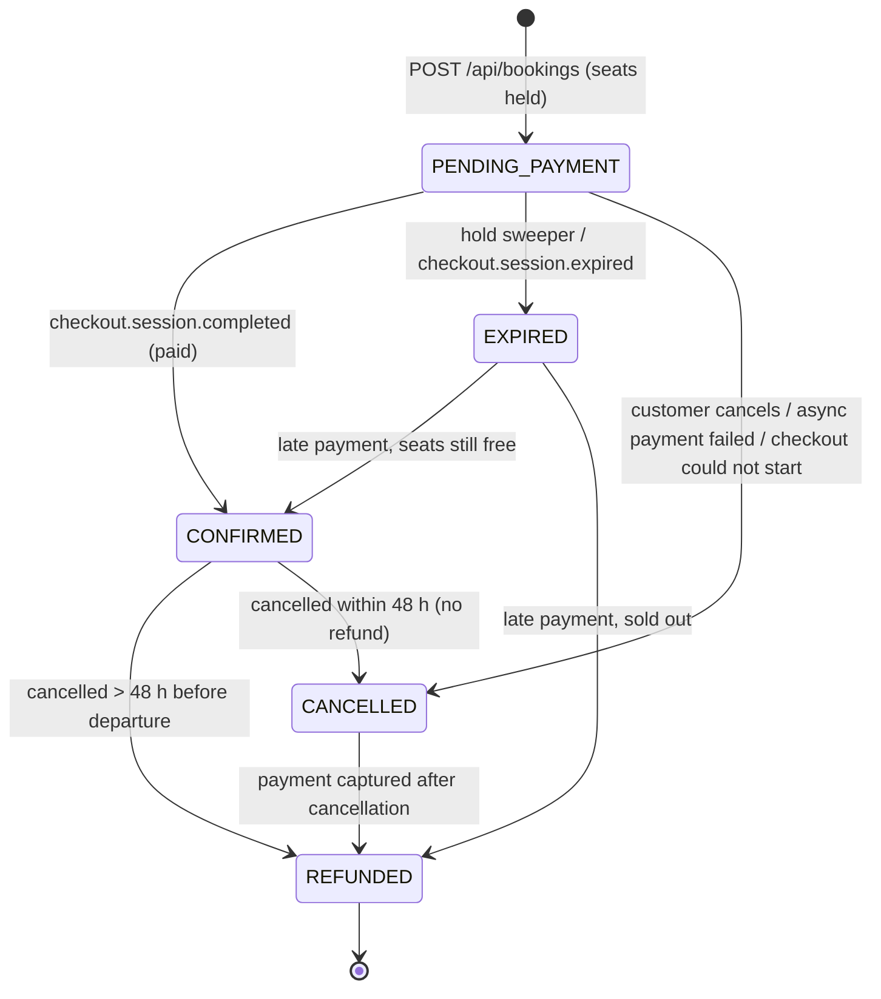

# 6. Hold-then-pay booking saga with a pluggable payment provider

Date: 2026-10-29 · Status: Accepted

## Context
Until Phase 1 a booking was CONFIRMED the moment its seats were reserved, with no payment at all.
Taking money adds a second system, the payment provider, that our database can't share a transaction
with. The seats must not be sold twice, a customer must not pay for a seat they don't get, and nobody
may hold seats forever by opening a checkout and walking away.

## Decision

### A saga of local transactions, each with a compensation

| Step | Local transaction | If the next step fails |
| --- | --- | --- |
| 1. Hold | Take seats (strategy from ADR 0002), insert a PENDING_PAYMENT booking with `hold_expires_at`, commit. | n/a |
| 2. Checkout | No transaction or lock is open. Call `PaymentProvider.create_checkout`, then store the `payments` row. | **Compensate**: release the seats, booking → CANCELLED (`checkout_failed`), clear its idempotency key, answer **502** Problem Details. |
| 3. Paid | Webhook: lock departure, then booking; → CONFIRMED. | The provider redelivers until we answer 2xx. |
| 4. Unpaid | Sweeper (or `checkout.session.expired`): → EXPIRED, seats released. | n/a |
| 5. Cancel | Early: → REFUNDED, payment REFUND_PENDING, commit, then `refund()`. Late: → CANCELLED, no refund. | A failed `refund()` leaves REFUND_PENDING; the sweeper retries it. |

Every allowed status change is in one table (`app/domain/booking_status.py`). `transition()` is the only
writer of `status`, raises a 409 Problem for anything else and logs
`booking.transition booking_id=… from=… to=… reason=…`.

**Never call the provider with a lock held.** Seats are committed before the checkout is created, and refunds
are decided and committed (REFUND_PENDING) before the provider is called. A slow PSP therefore stalls one
request, not every request queued on a popular departure.

### Holds and the provider's limits
A Stripe Checkout Session's `expires_at` must be 30 minutes to 24 hours after creation (Stripe API reference,
checked 2026-10-29). The hold is sized when it is created: `HOLD_MINUTES`, raised to the provider's minimum
plus a 2-minute clock margin (so 32 minutes with Stripe) and capped below its maximum. The session then
expires at exactly `hold_expires_at`: **the hold is never shorter than the session**. The parameters come
from stored state only, so a retry under the same idempotency key (`booking-<id>-checkout`) sends identical
parameters and gets the original session back, as Stripe requires.

### Hold sweeper
`python -m app.jobs.expire_holds` is its own process (its own compose service), every 60 s. Per departure it
locks the availability row, then the overdue holds `FOR UPDATE SKIP LOCKED` in batches, expires them and
releases their seats in one transaction. That keeps the lock order availability → booking. A second sweeper
queues on the departure lock and then no longer sees the expired holds, so seats are never released twice
(`tests/test_sweeper.py` races four sweepers). It also retries refunds left REFUND_PENDING.

### Webhooks
- Public route `POST /webhooks/stripe` at the gateway: its own security chain with no bearer-token
  processing, no identity headers, body forwarded byte for byte, 256 KB limit.
- booking-service verifies `Stripe-Signature` (HMAC-SHA256 over the raw bytes, 5-minute tolerance) with the
  official SDK and answers **400** to anything unsigned, tampered or replayed.
- Exactly once per event: `event.id` is inserted into `processed_webhook_events` in the same transaction as
  the state change. A redelivery is a no-op. A crash rolls back both, so the redelivery still applies.
- Handled: `checkout.session.completed` (only when `payment_status = paid`; unpaid waits for
  `async_payment_succeeded` / `_failed`) and `checkout.session.expired`. Everything else is acknowledged.

### Late payment
The customer can pay at the last second and the `completed` event can arrive after the sweeper expired the
hold. Under the departure lock:
- **Seats still free**: take them again and confirm (EXPIRED → CONFIRMED, `late_payment_seats_rereserved`).
- **Sold out**: the money must go back. EXPIRED → REFUNDED and payment REFUND_PENDING, committed with the
  event. `refund()` runs after the 2xx (a background task), and the sweeper retries it if that fails.

The same rule refunds a payment that lands after the customer cancelled. Nobody is ever oversold to honour
a late payment, and no payment is kept without a seat. Covered in `tests/test_webhooks.py::TestLatePayment`.

### Pluggable provider and currency
Booking logic depends on the `PaymentProvider` protocol (`create_checkout`, `expire_checkout`, `refund`,
`parse_webhook`), never on an SDK. `StripeProvider` uses the official `stripe` SDK (16.0.1, API version
`2026-09-30.endive`). `FakePaymentProvider` serves tests, offline development and the load benchmark, and
speaks Stripe's webhook format, so the same verification code runs either way. **Stripe doesn't onboard
Namibian merchants**, so a production launch in Namibia would need a local PSP. This interface is what lets
one slot in without touching the booking saga.

Currency: NAD **is** a Stripe presentment currency (two decimals, not marked as unsupported by American
Express on Stripe's currency list, checked 2026-10-29). We therefore charge in NAD, the tour's own currency,
in integer minor units. No conversion is needed. Had NAD not been supported, ZAR would have worked 1:1, since
NAD is pegged to ZAR. Stripe's minimum charge is set by the settlement currency (0.50 USD or the equivalent),
far below any tour price.

## Why not two-phase commit
- The provider doesn't take part in XA/2PC. No PSP offers a prepare/commit protocol, only HTTP calls
  and webhooks.
- 2PC holds locks across a network round trip to a third party. A slow PSP would freeze the seat counter of
  the most popular departures, which is exactly the contention ADR 0002 works to avoid.
- A coordinator crash leaves participants in doubt with their locks held, which needs manual recovery.
- The domain already has an explicit "pending" state and a natural compensation for each step (release the
  seats, refund). The saga writes these down, and every intermediate state can be seen in the database.

## Consequences
- The system is eventually consistent for up to `HOLD_MINUTES` + the sweep interval: seats may be held by
  someone who never pays. That is the price of not overselling.
- Async payment methods that settle after the hold expires take the late-payment path: they confirm if
  seats are still free, otherwise they are refunded. Restrict Checkout to cards if that is unacceptable.
- Webhooks must be reachable, so the gateway exposes one unauthenticated route. Its security rests on the
  signature secret, which must be rotated if leaked.
- Refunds are at-least-once attempts, made idempotent by provider idempotency keys (`booking-<id>-refund`).
- Still to do (Phase 4): booking events (`booking.confirmed`, …) through a transactional outbox, and
  notifications. Reconciling against the provider's event list (in case webhooks are lost for more than the
  provider's 3-day retry window) is not built.
