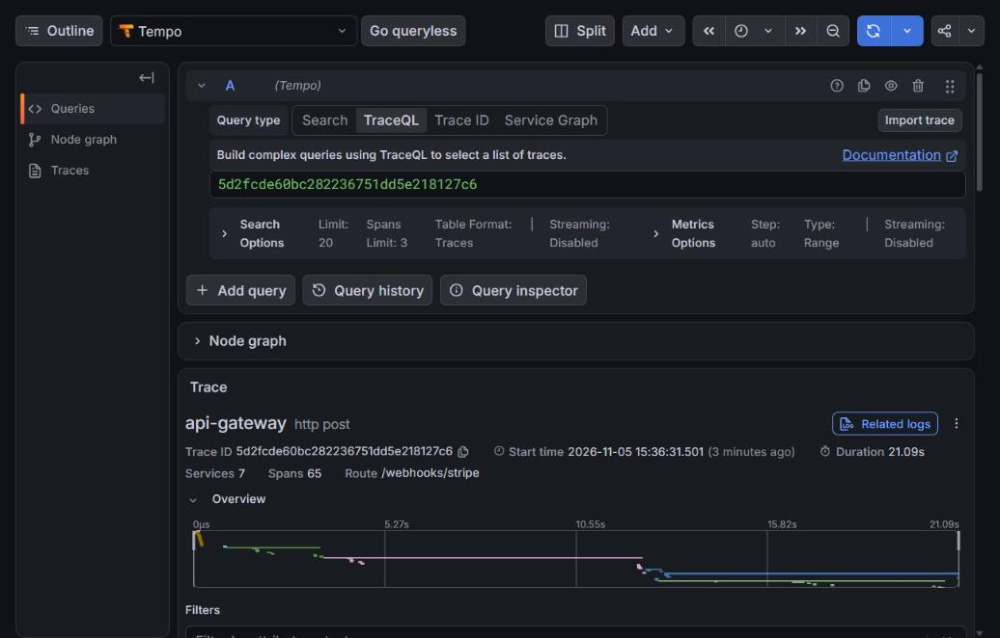
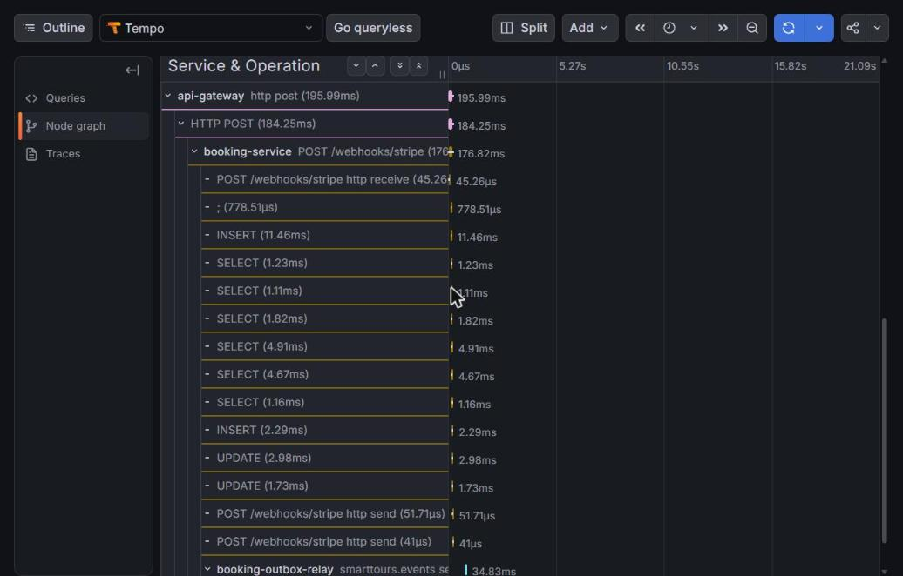

# 17. Observability, and trace propagation through the outbox

Date: 2026-11-05 · Status: Accepted

## Context
A booking's work crosses five services, a database row, two RabbitMQ vhosts and a Celery chain. When an email is late
there was no way to follow it: each service logged on its own, and metrics stopped at per-service gauges. Automatic
trace propagation doesn't survive the outbox either, because the row is written in one process and published later by
another (ADR 0008, ADR 0013), with no request context left to propagate.

## Decision
**OpenTelemetry for traces, metrics and logs in all five services, off by default.** The observability profile turns it
on (`infra/observability/observability.env`), so the default stack exports nothing. In the JVMs that is the `otlp` Spring
profile. The SDK and a tracer still exist with it off, sampling nothing; Python has no SDK at all without an endpoint.

- **Java:** Spring Boot 4's `spring-boot-starter-opentelemetry` rather than the OTel Java agent. It needs no agent
  attached at start and goes through Micrometer, which these services already use. Logs aren't part of Boot, so each
  JVM installs the Logback appender itself (`opentelemetry-logback-appender-1.0`, the release built on the SDK version
  Boot manages).
- **Python:** the SDK with the FastAPI, psycopg, httpx, pika and Celery instrumentations (`app/telemetry.py`, the same
  file per service). SQL spans come from **psycopg, not SQLAlchemy**: the SQLAlchemy instrumentor declares
  `sqlalchemy<2.1.0` and this repo is on 2.1.
- **Logs:** JSON on stdout always, with `trace_id`, `span_id`, service and version, so a line can be found from its
  trace and the reverse. Spring's ECS format, renamed to those two field names; a small formatter in Python. Uvicorn's
  own handlers are replaced so that its lines are JSON too.

**Each outbox row stores the W3C `traceparent` of the transaction that wrote it** (a nullable column in all three
outboxes). The relay publishes inside that context, so the message carries the original trace in its headers, and the
consumer continues it: PikaInstrumentor for the bridge, the ticket listener and the AI worker, Spring AMQP's observation
for tour-core's listeners. Celery's instrumentation carries it on through task headers, including the second step of a
chain, which is enqueued from inside the first.

    POST /webhooks/stripe (gateway -> booking-service): transaction writes booking.confirmed with its traceparent
      -> booking-outbox-relay publishes -> RabbitMQ -> notification-bridge -> notification-worker renders
      -> notification-email-worker sends
      -> relay publishes ticket.rendered -> booking-ticket-listener records it

The relays also write the `traceparent` header themselves instead of leaving it to instrumentation, so a row's trace
survives even when the relay's own exporter is off.

**The trace starts at the request that causes the event.** For a confirmation email that is the payment webhook, not
the earlier `POST /api/bookings` that took the hold, which is a separate trace. Linking the two would mean storing the
hold's trace on the booking; it isn't done.

**Noise is removed on purpose.** No spans for health checks, scrapes, `@Scheduled` polling, Spring Security's filter
chain, or a relay's empty polling SELECT (`database=False`). A relay that polls every second would otherwise produce
most of the traces in the system.

**Backend: `grafana/otel-lgtm`**, one container with the Collector, Tempo, Prometheus, Loki and Grafana, provisioned
from `infra/observability`. Its authors describe it as for development and demos, which is what the local profile is.
Production gets separate components (Part B). RabbitMQ's numbers come from its Prometheus plugin
(`/metrics/detailed`, per queue, since the default `/metrics` aggregates queues away), and gauges that services compute
from their database (`outbox_*`, `notifications`) are scraped, so every process agrees on them.

Dashboards and alert rules are files, loaded on start. `docs/slo.md` holds the objectives and what each alert means.

`scripts/trace_booking.py` produces such a trace and fails unless every hop is in it. Measured: 65 spans over 21 s across
`api-gateway`, `booking-service`, `booking-outbox-relay`, `notification-bridge`, `notification-worker`,
`notification-email-worker` and `booking-ticket-listener`, with 21 log lines in Loki under the same trace id.

## Consequences
- **It doesn't all fit on the laptop at once.** See the [memory table](../benchmarks/notifications.md#memory-budget).
  Core plus observability is stable. Adding the notifications profile fills a 3.7 GiB Docker VM within minutes of
  use: swap ran out, memory pressure reached 70% (fully stalled), and Docker's own API started failing. One end-to-end
  trace fits in that window; running it for long doesn't.
- **Writes get one small column.** `traceparent` is 55 bytes on each outbox row, and rows are pruned after 7 days.
- **Metric names differ between stacks.** Spring exports `http_server_requests_milliseconds_*` with `status` and `uri`;
  FastAPI exports `http_server_duration_milliseconds_*` with `http_status_code` and `http_target`. Each RED panel queries
  both. The OTel Python instrumentation can move to the newer semantic conventions; dashboards would need to follow.
- **Bucket labels are literal strings.** Alerts match `le="500"`. Micrometer gets an explicit bucket there
  (`management.metrics.distribution.slo`). A wrong label doesn't error, it just never fires: the first draft of the
  search latency alert had this bug, found by querying real data. A new latency alert should be checked the same way.
- **The default stack needs its own check.** Spring's test support disables tracing, so a crash in exactly this wiring
  (an empty endpoint from compose) passed every test. `StartupDefaultsIntegrationTest` and `StartupProfilesTest` boot
  with tracing on, and CI starts the default stack for real.
- **Sampling is 100% locally** and needs lowering for production traffic, with the parent's decision followed
  downstream (the default for both SDKs). A row written outside a sampled trace stores no `traceparent`, so with
  the profile off the column stays empty.
